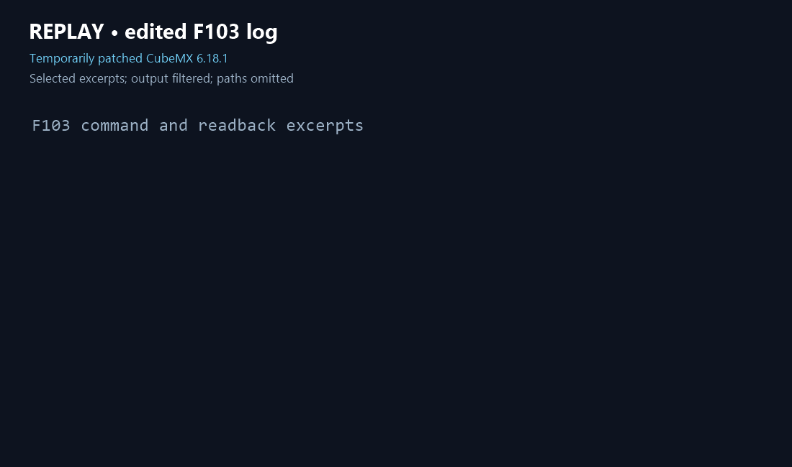

# STM32CubeMX Skill

**English** | [简体中文](README.zh-CN.md)

## What it does

This skill helps AI coding assistants inspect STM32CubeMX-managed configuration, change and read back settings, generate code in a project copy, and review the resulting files. Its Python controller sends interactive CubeMX commands one at a time and stops on detected errors; the repository also includes environment and output checks and recorded probe findings.

The demonstration is a replay of selected logs from a real F103 run, not a live screen recording. That run used a temporarily corrected CubeMX 6.18.1 generator. Output checks do not establish that the project builds or works on hardware.

## Installation and requirements

Clone this repository as `stm32cubemx` inside your assistant's skills directory (for example, `~/.codex/skills`, `~/.claude/skills`, `~/.agents/skills` for the default DeepSeek Harness configuration, or `~/.zcode/skills` for ZCode). Keep the repository's directory structure. If the destination already exists, inspect it before updating. Reload your assistant, then invoke `stm32cubemx` using its skill command; see the [platform-specific instructions](README.zh-CN.md#安装).

Use `$stm32cubemx` in Codex, `/stm32cubemx` in Claude Code or DSH, and `$stm32cubemx` in ZCode after refreshing and enabling the skill in settings. DSH discovery depends on its profile, plugins and environment settings. Consult the [Claude Code](https://code.claude.com/docs/en/skills), [DSH](https://github.com/deepseek-ai/deepseek-harness/blob/master/packages/skill/skill-filesystem/README.md) and [ZCode](https://zcode.z.ai/cn/docs/skill) documentation for your version.

You need STM32CubeMX, Python 3 and the target's local firmware package; a compatible toolchain is also needed for builds. ST software, firmware packages and probe patches are not included. This repository currently has no open-source license; contact the rights holder for permissions beyond the legal defaults.

## Usage and verification

Start with [SKILL.md](SKILL.md) and the target project's actual `.ioc` and generated files. Back up the project and first work in a temporary copy. Read back changes, inspect the complete log and generated files, and review differences before applying them to the original; see the [verification workflow](references/verification.md). The controller does not isolate network access, undo file changes or validate hardware. Interactive behavior has been tested on Windows with CubeMX 6.18.1; verify the command and response formats before using another version. Run the repository tests with `python -m unittest discover -s tests -v`; they do not replace generation, build or hardware checks.
