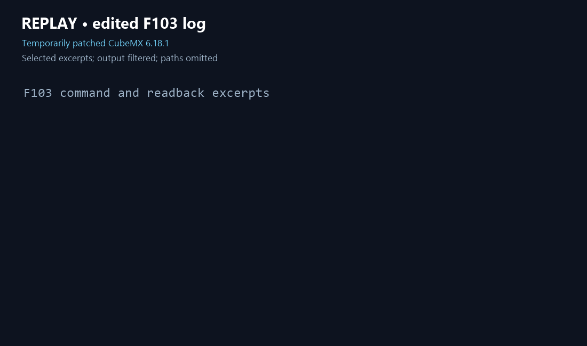

# STM32CubeMX Skill

[English](README.md) | **简体中文**

[](https://github.com/tian11111/stm32cubemx-skill/actions/workflows/tests.yml)



此演示重放了真实 F103 运行中的部分日志，并非实时录屏。该次运行使用临时修正的 CubeMX 6.18.1 生成器；输出检查通过不代表工程已编译或硬件运行成功。

面向支持 `SKILL.md` 的 AI 编程助手的 STM32CubeMX 配置与代码生成技能，包含逐条检查交互命令的 Python 控制器和本地探针结果摘要。

## 安装

技能正文、脚本与参考资料共用一套，保留目录结构即可。目标目录不存在时，在 PowerShell 按所用助手选择一条命令：

```powershell
git clone https://github.com/tian11111/stm32cubemx-skill.git "$env:USERPROFILE\.codex\skills\stm32cubemx"
# Claude Code
git clone https://github.com/tian11111/stm32cubemx-skill.git "$env:USERPROFILE\.claude\skills\stm32cubemx"
# DeepSeek Harness（DSH 默认同时读取 .agents/skills）
git clone https://github.com/tian11111/stm32cubemx-skill.git "$env:USERPROFILE\.agents\skills\stm32cubemx"
# 智谱 ZCode Agent
git clone https://github.com/tian11111/stm32cubemx-skill.git "$env:USERPROFILE\.zcode\skills\stm32cubemx"
```

如果本机已安装目标目录，不能直接用上述 clone 命令覆盖；先检查现有内容并备份，再选择单独目录克隆或自行处理更新。重新加载助手后，Codex 使用 `$stm32cubemx`，Claude Code 使用 `/stm32cubemx`，DSH 可使用 `/stm32cubemx`，ZCode Agent 在设置页刷新并启用后使用 `$stm32cubemx`。DSH 的路径可由 `DSH_AGENTS_HOME` 等环境变量及 profile 配置改变；技能发现还依赖对应插件启用。具体以所用版本和配置为准，参见 [Claude Code](https://code.claude.com/docs/en/skills)、[DSH](https://github.com/deepseek-ai/deepseek-harness/blob/master/packages/skill/skill-filesystem/README.md) 和 [ZCode](https://zcode.z.ai/cn/docs/skill) 文档。

需要已安装的 STM32CubeMX、Python 3 和目标器件所需的本地固件包；构建还需兼容的本机工具链。本仓库不分发 ST 软件、固件包或探针补丁。

使用入口和控制器计划格式见 [SKILL.md](SKILL.md)，历史实测边界及启动模板见 [探针记录](references/probe-record.md)。操作前备份工程，先在临时副本验证。控制器不会隔离网络、回滚文件或验证硬件。

Windows 用户可参考[实验性离线启动方案](references/offline-windows.md)。它需要自行准备独立的应用副本和目录权限，不能保证完整文件隔离；仓库不包含已经配置好的 CubeMX 运行副本。

生成后的显式验收、快照和构建检查见[验收工作流](references/verification.md)；TIM、I2C、USART 等场景的注意事项见[外设检查清单](references/peripherals.md)。`doctor.py` 是只读环境探测，不会自动安装工具或启动 CubeMX。

## F103 示例的固件路径

如果你已有 `FixedF103Patched` 示例的完整生成基线，可以用下列命令在**不存在的新目录**准备独立副本。需要自行提供 STM32Cube FW_F1 V1.8.7 固件包和基线；本仓库不包含它们。

```powershell
python scripts/prepare_fixture.py --baseline '<生成基线目录>' --firmware '<FW_F1_V1.8.7 目录>' --destination '<新工作目录>'
```

脚本校验版本、必要文件和基线中的相对路径，并复制文件到固定的 `output/FixedF103Patched` 与 `firmware-f1` 布局。它不会修改输入目录或启动 CubeMX；完整使用和限制见[探针记录](references/probe-record.md)。

没有现成基线时，可按 [F103 示例准备](references/f103-fixture.md)使用本机固件和已准备的 CubeMX 交互环境从零重建。原版 6.18.1 首次生成存在已观察到的路径问题，脚本会在错误或缺文件时停止，不会修改 CubeMX 安装或自动修补。

在 Windows 和 CubeMX 6.18.1 的本机测试中，该布局通过加载、修改、重生成和验收。此前偶发的 `0xC0000008` 在 3 次版本查询、3 次重生成和 8 次带退出诊断的重生成中未再复现，**原因尚未确定**；这些通过结果不能排除偶发问题。相关生成验证使用了临时生成器路径修正，不代表未修改的 CubeMX 在所有机器上均可首次生成成功。

## 测试

在仓库根目录运行：

```powershell
python -m unittest discover -s tests -v
```

测试不能替代实际 CubeMX 生成、工具链构建或硬件验证。实测范围为 Windows 和 CubeMX 6.18.1；其他版本须先验证交互格式。

## 许可

本仓库暂未指定开源许可证；公开可见不等于授予开源使用权限。如需在法定默认权利之外复制、修改或再分发，请联系权利人。
